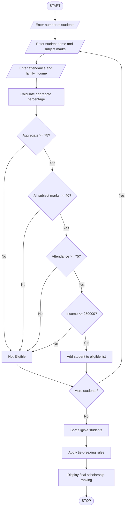

# 1. University Scholarship Allocation System

## 1. Problem Statement

The University Scholarship Allocation System is designed to identify and rank eligible students for scholarships based on their academic performance and financial background.

The system evaluates students using the following criteria:

1. Aggregate Marks: Student must score at least 75%.
2. Subject-wise Minimum Marks: Student must score at least 40 marks in every subject.
3. Attendance: Student must have at least 75% attendance.
4. Family Income: Annual family income must not exceed ₹2,50,000.

The system ranks eligible students based on aggregate marks in descending order. If students have equal aggregate marks, attendance is considered. If a tie still exists, lower family income is preferred, followed by alphabetical order of names.

## 2. Algorithm

1. Start the program.
2. Read the number of scholarship applicants.
3. Read each student's name.
4. Read subject-wise marks.
5. Calculate the aggregate percentage.
6. Read attendance percentage.
7. Read annual family income.
8. Check all eligibility conditions:
   - Aggregate marks ≥ 75%.
   - Every subject mark ≥ 40.
   - Attendance ≥ 75%.
   - Family income ≤ ₹2,50,000.
9. If all conditions are satisfied, add the student to the eligible list.
10. Otherwise, declare the student ineligible.
11. Sort eligible students using:
    - Aggregate marks (highest first).
    - Attendance (highest first).
    - Family income (lowest first).
    - Student name (alphabetical order).
12. Display the final scholarship ranking.
13. Stop the program.

## 3. Flowchart


## 4. Python Source Code

```
# University Scholarship Allocation Systemeligible_students = []# Eligibility criteriaMIN_AGGREGATE = 75MIN_SUBJECT_MARKS = 40MIN_ATTENDANCE = 75MAX_INCOME = 250000n = int(input("Enter number of students: "))for i in range(n):    print("\nEnter details of Student", i + 1)    name = input("Enter student name: ")    marks = []    subjects = int(input("Enter number of subjects: "))    for j in range(subjects):        mark = float(input(f"Enter marks in subject {j+1}: "))        marks.append(mark)    attendance = float(input("Enter attendance percentage: "))    income = float(input("Enter annual family income: "))    # Calculate aggregate percentage    aggregate = sum(marks) / subjects    # Check eligibility    if (aggregate >= MIN_AGGREGATE and        min(marks) >= MIN_SUBJECT_MARKS and
```

## 5. Sample Input

```
Enter number of students: 3

Enter details of Student 1
Enter student name: Asha
Enter number of subjects: 3
Enter marks in subject 1: 90
Enter marks in subject 2: 85
Enter marks in subject 3: 95
Enter attendance percentage: 95
Enter annual family income: 150000

Enter details of Student 2
Enter student name: Bala
Enter number of subjects: 3
Enter marks in subject 1: 90
Enter marks in subject 2: 85
Enter marks in subject 3: 95
Enter attendance percentage: 90
Enter annual family income: 120000

Enter details of Student 3
Enter student name: Chitra
Enter number of subjects: 3
Enter marks in subject 1: 70
Enter marks in subject 2: 80
Enter marks in subject 3: 75
Enter attendance percentage: 80
Enter annual family income: 200000
```

## 6. Sample Output

```
Asha is Eligible for Scholarship
Bala is Eligible for Scholarship
Chitra is Eligible for Scholarship

===== SCHOLARSHIP RANKING =====

Rank: 1
Name: Asha
Aggregate: 90.0 %
Attendance: 95.0 %
Family Income: Rs. 150000.0

Rank: 2
Name: Bala
Aggregate: 90.0 %
Attendance: 90.0 %
Family Income: Rs. 120000.0

Rank: 3
Name: Chitra
Aggregate: 75.0 %
Attendance: 80.0 %
Family Income: Rs. 200000.0
```

## 7. Mermaid Flowchart Code

