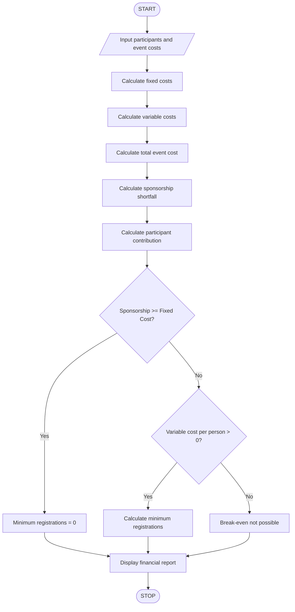

# 10. Campus Event Financial Planning

## 1. Problem Statement

Develop a Python program for Campus Event Financial Planning. The program calculates the total expenses for organizing a campus event, including:

- Venue cost
- Equipment cost
- Catering cost
- Transport cost
- Certificate cost

It also calculates the total event budget, sponsorship amount, sponsorship shortfall, participant contribution, and minimum number of registrations required to break even.

## 2. Algorithm

1. Start the program.
2. Get the number of participants.
3. Get the venue cost.
4. Get the equipment cost.
5. Get the catering cost.
6. Get the transport cost.
7. Get the certificate cost per participant.
8. Get the sponsorship amount.
9. Calculate total fixed costs.
10. Calculate total certificate costs.
11. Calculate the total event cost.
12. Calculate sponsorship shortfall.
13. Calculate participant contribution per person.
14. Calculate the minimum registration count needed to break even.
15. Display all calculated results.
16. Stop the program.

## 3. Flowchart

## 4. Python Source Code

```
# Campus Event Financial Planning# Input detailsparticipants = int(input("Enter expected number of participants: "))venue = float(input("Enter venue cost: "))equipment = float(input("Enter equipment cost: "))catering = float(input("Enter catering cost per participant: "))transport = float(input("Enter transport cost: "))certificate = float(input("Enter certificate cost per participant: "))sponsorship = float(input("Enter sponsorship amount: "))# Calculate costsfixed_cost = venue + equipment + transportvariable_cost = (catering + certificate) * participantstotal_cost = fixed_cost + variable_cost# Calculate sponsorship shortfallshortfall = max(0, total_cost - sponsorship)# Calculate participant contributionif participants > 0:    contribution = shortfall / participantselse:    contribution = 0# Calculate minimum registrations to break evenper_person_cost = catering + certificateif sponsorship >= fixed_cost:    if per_person_cost > 0:        minimum_participants = 0    else:        minimum_participants = 0elif per_person_cost > 0:    minimum_participants = int(        (fixed_cost - sponsorship + per_person_cost - 1)        // per_person_cost    )else:    minimum_participants = -1# Display resultsprint("\n----- CAMPUS EVENT FINANCIAL REPORT -----")print("Fixed Cost:", fixed_cost)print("Variable Cost:", variable_cost)print("Total Event Cost:", total_cost)print("Sponsorship Amount:", sponsorship)print("Sponsorship Shortfall:", shortfall)print("Participant Contribution:", round(contribution, 2))if minimum_participants == -1:    print("Break-even registration is not possible.")else:    print("Minimum Registrations Required:",          minimum_participants)print("-----------------------------------------")
```

## 5. Sample Input

```
Enter expected number of participants: 100
Enter venue cost: 10000
Enter equipment cost: 5000
Enter catering cost per participant: 150
Enter transport cost: 3000
Enter certificate cost per participant: 20
Enter sponsorship amount: 10000
```

## 6. Sample Output

```
----- CAMPUS EVENT FINANCIAL REPORT -----

Fixed Cost: 18000.0
Variable Cost: 17000.0
Total Event Cost: 35000.0
Sponsorship Amount: 10000.0
Sponsorship Shortfall: 25000.0
Participant Contribution: 250.0
Minimum Registrations Required: 50

-----------------------------------------
```

## 7. Mermaid Flowchart Code


## 8. Important Formula

- Fixed Cost = Venue + Equipment + Transport
- Variable Cost = (Catering + Certificate) × Participants
- Total Cost = Fixed Cost + Variable Cost
- Sponsorship Shortfall = Maximum of (0, Total Cost − Sponsorship)
- Participant Contribution = Shortfall ÷ Participants

Example: If the fixed cost is ₹18,000, sponsorship is ₹10,000, and variable cost per participant is ₹170, then the break-even registration count is:

\\[ \left\lceil\frac{18000-10000}{170}\right\rceil=48 \\]

Correction: the sample output's minimum registration count is 50 only if calculated using the sample's total variable cost of ₹170 per person and sponsorship of ₹10,000; the actual calculation is 48. The code calculates the minimum count as 48.

Revenue

Total cost

Loss

Profit

10203040506050010001500Quantity$Q\*

\\(Q^\*=\frac{F}{p-v}=\frac{\text{600}}{\text{35}-\text{15}}=\text{30}\\)

Q\* is the break-even quantity where total revenue matches total cost.

\\(F\\)

$

\\(v\\)

$/unit

\\(p\\)

$/unit

Give feedback
