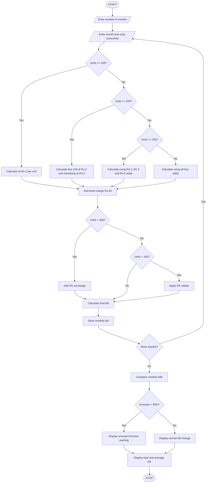

# 2. Progressive Electricity Billing System

## 1. Problem Statement

The Progressive Electricity Billing System is designed to calculate household electricity bills based on the number of units consumed every month.

The system uses multiple electricity consumption slabs, fixed charges, surcharges, and rebates to calculate the final bill. It also compares electricity bills across several months and identifies unusual increases in monthly bills.

Billing rules used in this program (example rates):

| Electricity consumption | Rate per unit |
| ----------------------- | ------------- |
| First 100 units         | ₹2            |
| 101–200 units           | ₹3            |
| 201–300 units           | ₹5            |
| Above 300 units         | ₹7            |

Additional rules:

- Fixed charge: ₹50 per month.
- Surcharge: 5% if consumption exceeds 300 units.
- Rebate: 5% if consumption is below 100 units.
- Unusual increase: If the current month's bill increases by more than 30% compared with the previous month, display a warning.

These are example rates for an academic project, not official electricity tariff rates.

## 2. Algorithm

1. Start the program.
2. Enter the number of months.
3. For each month, enter electricity units consumed.
4. Calculate the energy charge using progressive slabs:
   - First 100 units × ₹2.
   - Next 100 units × ₹3.
   - Next 100 units × ₹5.
   - Remaining units × ₹7.
5. Add the fixed charge of ₹50.
6. Check whether consumption exceeds 300 units.
7. If yes, add a 5% surcharge.
8. If consumption is below 100 units, apply a 5% rebate.
9. Calculate the final electricity bill.
10. Store the monthly bill.
11. Compare each month's bill with the previous month's bill.
12. If the increase is greater than 30%, identify it as an unusual increase.
13. Display all monthly bills and the total amount.
14. Stop the program.

## 3. Flowchart


## 4. Python Source Code

```
# Progressive Electricity Billing Systembills = []months = []# Billing calculation functiondef calculate_bill(units):    # Progressive slab calculation    if units <= 100:        energy_charge = units * 2    elif units <= 200:        energy_charge = (100 * 2) + (units - 100) * 3    elif units <= 300:        energy_charge = (100 * 2) + (100 * 3) + (units - 200) * 5    else:        energy_charge = (100 * 2) + (100 * 3) + (100 * 5) + (units - 300) * 7    # Fixed charge    fixed_charge = 50    subtotal = energy_charge + fixed_charge    # Surcharge and rebate    surcharge = 0    rebate = 0    if units > 300:        surcharge = subtotal * 0.05    elif units < 100:        rebate = subtotal * 0.05    # Final bill    final_bill = subtotal + surcharge - rebate    return energy_charge, fixed_charge, surcharge, rebate, final_bill# Get monthly consumptionn = int(input("Enter number of months: "))for i in range(n):    print("\nMonth", i + 1)    month = input("Enter month name: ")    units = float(input("Enter electricity units: "))    if units < 0:        print("Invalid units!")        continue    energy, fixed, surcharge, rebate, bill = calculate_bill(units)    months.append(month)    bills.append(bill)
```

## 5. Sample Input

```
Enter number of months: 4

Month 1
Enter month name: January
Enter electricity units: 80

Month 2
Enter month name: February
Enter electricity units: 120

Month 3
Enter month name: March
Enter electricity units: 180

Month 4
Enter month name: April
Enter electricity units: 350
```

## 6. Sample Output

```
Month 1
Energy Charge: Rs. 160.0
Fixed Charge: Rs. 50
Surcharge: Rs. 0
Rebate: Rs. 10.5
Final Bill: Rs. 199.5

Month 2
Energy Charge: Rs. 260.0
Fixed Charge: Rs. 50
Surcharge: Rs. 0
Rebate: Rs. 0
Final Bill: Rs. 310.0

Month 3
Energy Charge: Rs. 440.0
Fixed Charge: Rs. 50
Surcharge: Rs. 0
Rebate: Rs. 0
Final Bill: Rs. 490.0

Month 4
Energy Charge: Rs. 1350.0
Fixed Charge: Rs. 50
Surcharge: Rs. 70.0
Rebate: Rs. 0
Final Bill: Rs. 1470.0

===== MONTHLY BILL COMPARISON =====

January : Rs. 199.5

February : Rs. 310.0
Bill Change: 55.39 %
WARNING: Unusual increase detected!

March : Rs. 490.0
Bill Change: 58.06 %
WARNING: Unusual increase detected!

April : Rs. 1470.0
Bill Change: 200.0 %
WARNING: Unusual increase detected!

Total Electricity Bill: Rs. 2469.5
Average Monthly Bill: Rs. 617.38
```

## 7. Mermaid Flowchart Code


## 8. Conclusion

The Progressive Electricity Billing System calculates electricity bills using multiple consumption slabs, fixed charges, surcharges, and rebates. It compares monthly electricity bills, calculates the total and average bill, and identifies unusual increases using a 30% threshold.

Program completed
