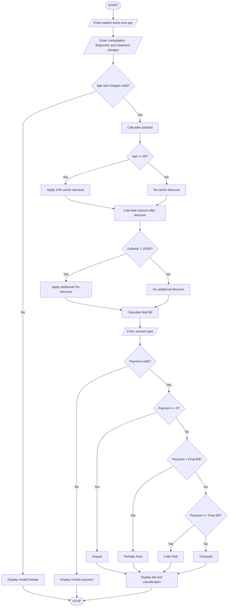

# 3. Hospital Billing and Patient Classification System

## 1. Problem Statement

The Hospital Billing and Patient Classification System is designed to calculate the total hospital bill based on consultation charges, diagnostic charges, and treatment charges.

The system applies conditional concessions, validates billing constraints, and classifies patients according to their payment status.

Rules used in this program (example policy):

1. Consultation charge: ₹500.
2. Diagnostic charge: ₹1,000.
3. Treatment charge: Depends on the treatment selected.
4. Senior citizens (age 60 and above) receive a 10% concession.
5. Patients with bills above ₹10,000 receive an additional 5% concession.
6. Total bill cannot be negative.
7. Payment classification:
   - Fully Paid: Amount paid equals the final bill.
   - Partially Paid: Amount paid is greater than zero but less than the final bill.
   - Unpaid: No payment has been made.
   - Overpaid: Amount paid exceeds the final bill.

The above rates and concessions are sample academic project rules, not actual hospital tariffs.

## 2. Algorithm

1. Start the program.
2. Enter the patient name and age.
3. Enter consultation charges.
4. Enter diagnostic charges.
5. Enter treatment charges.
6. Validate that all charges are non-negative.
7. Calculate the subtotal of all charges.
8. Check whether the patient is a senior citizen.
9. If age is 60 or above, apply a 10% concession.
10. If the subtotal exceeds ₹10,000, apply an additional 5% concession.
11. Calculate the final bill.
12. Enter the amount paid by the patient.
13. Validate the payment amount.
14. Classify the patient as Fully Paid, Partially Paid, Unpaid, or Overpaid.
15. Display the complete bill details and payment classification.
16. Stop the program.

## 3. Flowchart

## 4. Python Source Code

```
    # Calculate subtotal    subtotal = consultation + diagnostic + treatment    # Calculate concessions    senior_discount = 0    extra_discount = 0    # Senior citizen concession    if age >= 60:        senior_discount = subtotal * 0.10    amount_after_senior = subtotal - senior_discount    # Additional concession for bills above Rs. 10000    if subtotal > 10000:        extra_discount = amount_after_senior * 0.05    # Final bill    total_discount = senior_discount + extra_discount    final_bill = subtotal - total_discount    # Display bill    print("\n===== BILL DETAILS =====")    print("Patient Name:", name)    print("Patient Age:", age)    print("Consultation Charges: Rs.", consultation)    print("Diagnostic Charges: Rs.", diagnostic)    print("Treatment Charges: Rs.", treatment)    print("Subtotal: Rs.", subtotal)    print("Senior Discount: Rs.", senior_discount)    print("Additional Discount: Rs.", extra_discount)    print("Total Discount: Rs.", total_discount)    print("Final Bill: Rs.", round(final_bill, 2))    # Payment details    paid = float(input("\nEnter amount paid: Rs. "))    if paid < 0:        print("Invalid payment amount!")    else:        # Patient payment classification        if paid == 0:            status = "UNPAID"            balance = final_bill        elif paid < final_bill:            status = "PARTIALLY PAID"            balance = final_bill - paid        elif paid == final_bill:            status = "FULLY PAID"            balance = 0        else:            status = "OVERPAID"            balance = paid - final_bill        # Final output        print("\n===== PAYMENT CLASSIFICATION =====")        print("Patient Name:", name)        print("Payment Status:", status)        if status == "OVERPAID":            print("Extra Amount: Rs.", round(balance, 2))        else:            print("Remaining Balance: Rs.", round(balance, 2))
```

## 5. Sample Input

```
===== HOSPITAL BILLING SYSTEM =====

Enter patient name: Siva
Enter patient age: 65

Enter consultation charges: Rs. 500
Enter diagnostic charges: Rs. 3000
Enter treatment charges: Rs. 8000

Enter amount paid: Rs. 5000
```

## 6. Sample Output

```
===== BILL DETAILS =====

Patient Name: Siva
Patient Age: 65

Consultation Charges: Rs. 500.0
Diagnostic Charges: Rs. 3000.0
Treatment Charges: Rs. 8000.0

Subtotal: Rs. 11500.0
Senior Discount: Rs. 1150.0
Additional Discount: Rs. 517.5
Total Discount: Rs. 1667.5

Final Bill: Rs. 9832.5

===== PAYMENT CLASSIFICATION =====

Patient Name: Siva
Payment Status: PARTIALLY PAID
Remaining Balance: Rs. 4832.5

Thank you!
```

## 7. Payment Classification Examples

| Payment condition         | Classification |
| ------------------------- | -------------- |
| Payment = ₹0              | Unpaid         |
| Payment less than bill    | Partially Paid |
| Payment equals bill       | Fully Paid     |
| Payment greater than bill | Overpaid       |

## 8. Mermaid Flowchart Code


## 9. Conclusion

The Hospital Billing and Patient Classification System calculates hospital charges, applies senior citizen and additional concessions, validates billing details, and classifies patients according to their payment status.

Program completed
