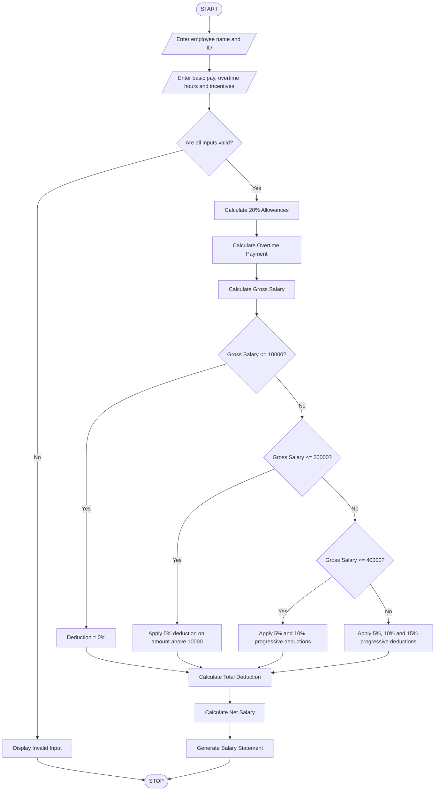

# 4. Employee Payroll and Deduction Analysis System

## 1. Problem Statement

The Employee Payroll and Deduction Analysis System is designed to calculate an employee's monthly salary based on basic pay, allowances, overtime, and incentives.

The system calculates the gross salary and applies progressive deductions based on predefined salary slabs. Finally, it generates a formatted salary statement showing gross salary, deductions, and net salary.

Rules used in this program (example academic payroll policy):

1. Basic Pay: Entered by the user.
2. Allowances: 20% of basic pay.
3. Overtime: Number of overtime hours × ₹200.
4. Incentives: Entered by the user.
5. Gross Salary = Basic Pay + Allowances + Overtime + Incentives.

Progressive deductions:

| Gross salary slab | Deduction rate |
| ----------------- | -------------- |
| First ₹10,000     | 0%             |
| Next ₹10,000      | 5%             |
| Next ₹20,000      | 10%            |
| Above ₹40,000     | 15%            |

These are illustrative rates for a programming assignment, not official tax or payroll rules.

## 2. Algorithm

1. Start the program.
2. Enter employee name and employee ID.
3. Enter basic salary.
4. Calculate allowances as 20% of basic salary.
5. Enter overtime hours.
6. Calculate overtime payment at ₹200 per hour.
7. Enter employee incentives.
8. Calculate gross salary.
9. Apply progressive deductions:
   - First ₹10,000: 0%.
   - Next ₹10,000: 5%.
   - Next ₹20,000: 10%.
   - Remaining amount: 15%.
10. Calculate total deductions.
11. Calculate net salary using gross salary minus deductions.
12. Validate all input values.
13. Display the formatted salary statement.
14. Stop the program.

## 3. Flowchart


## 4. Python Source Code

```
# Employee Payroll and Deduction Analysis Systemprint("===== EMPLOYEE PAYROLL SYSTEM =====")# Employee detailsname = input("Enter employee name: ")emp_id = input("Enter employee ID: ")basic = float(input("Enter basic pay: Rs. "))overtime_hours = float(input("Enter overtime hours: "))incentives = float(input("Enter incentives: Rs. "))# Validate inputif basic < 0 or overtime_hours < 0 or incentives < 0:    print("Invalid Input! Values cannot be negative.")else:    # Calculate allowances    allowances = basic * 0.20    # Calculate overtime payment    overtime = overtime_hours * 200    # Calculate gross salary    gross = basic + allowances + overtime + incentives    # Progressive deduction calculation    if gross <= 10000:        deduction = 0    elif gross <= 20000:        deduction = (gross - 10000) * 0.05
```

## 5. Sample Input

```
===== EMPLOYEE PAYROLL SYSTEM =====

Enter employee name: Siva
Enter employee ID: EMP101

Enter basic pay: Rs. 30000
Enter overtime hours: 10
Enter incentives: Rs. 3000
```

## 6. Sample Output

```
===================================
       EMPLOYEE SALARY STATEMENT
===================================

Employee Name       : Siva
Employee ID         : EMP101

-----------------------------------
Basic Pay           : Rs. 30000.0
Allowances (20%)    : Rs. 6000.0
Overtime Payment    : Rs. 2000.0
Incentives          : Rs. 3000.0

-----------------------------------
Gross Salary        : Rs. 41000.0
Total Deduction     : Rs. 2650.0
-----------------------------------
NET SALARY          : Rs. 38350.0
===================================

Salary calculation completed!
```

## 7. Mermaid Flowchart Code


## 8. Conclusion

The Employee Payroll and Deduction Analysis System calculates gross salary using basic pay, allowances, overtime, and incentives. It applies progressive deductions based on salary slabs and generates a formatted salary statement showing total deductions and final net salary.

Program completed

I can also prepare another Python programming assignment with its algorithm, flowchart, source code, and sample output.

🐍Daily Python practice exercisesTap to set up
