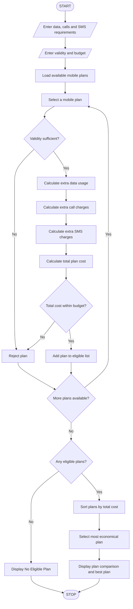

# 5. Multi-Plan Telecommunications Cost Optimization System

## 1. Problem Statement

The Multi-Plan Telecommunications Cost Optimization System is designed to compare different mobile recharge plans based on data usage, call minutes, SMS usage, validity, and budget constraints.

The system calculates the total cost of each mobile plan, including additional charges for exceeding the allowed usage limits.

It identifies the most economical mobile plan that satisfies the user's requirements and budget.

Example mobile plan details:

| Plan   | Price | Data | Calls   | SMS | Validity |
| ------ | ----- | ---- | ------- | --- | -------- |
| Plan A | ₹199  | 2 GB | 100 min | 100 | 28 days  |
| Plan B | ₹299  | 3 GB | 200 min | 200 | 28 days  |
| Plan C | ₹399  | 5 GB | 300 min | 300 | 56 days  |

Additional charges:

- Extra data: ₹20 per GB.
- Extra call minutes: ₹1 per minute.
- Extra SMS: ₹0.50 per SMS.
- User provides maximum budget and minimum validity requirements.

These are sample rates for an academic project, not actual telecom tariffs.

## 2. Algorithm

1. Start the program.
2. Enter the required data usage in GB.
3. Enter the required call minutes.
4. Enter the required SMS count.
5. Enter the minimum validity required.
6. Enter the maximum budget.
7. Define the available mobile plans.
8. Read each plan's price, data limit, call limit, SMS limit, and validity.
9. Check whether the plan satisfies the validity requirement.
10. Calculate excess data, call, and SMS charges.
11. Calculate the total plan cost.
12. Check whether the total cost is within the budget.
13. Store all eligible plans.
14. Sort eligible plans by total cost in ascending order.
15. Display the most economical eligible plan.
16. If no plan is eligible, display a suitable message.
17. Stop the program.

## 3. Flowchart


## 4. Python Source Code

```
# Multi-Plan Telecommunications Cost Optimizationprint("===== MOBILE PLAN OPTIMIZATION SYSTEM =====")# Available mobile plansplans = [    {        "name": "Plan A",        "price": 199,        "data": 2,        "calls": 100,        "sms": 100,        "validity": 28    },    {        "name": "Plan B",        "price": 299,        "data": 3,        "calls": 200,        "sms": 200,        "validity": 28    },    {        "name": "Plan C",        "price": 399,        "data": 5,        "calls": 300,        "sms": 300,        "validity": 56    }]# User requirementsdata_needed = float(input("Enter required data (GB): "))calls_needed = int(input("Enter required call minutes: "))
```

## 5. Sample Input

```
===== MOBILE PLAN OPTIMIZATION SYSTEM =====

Enter required data (GB): 4
Enter required call minutes: 250
Enter required SMS count: 250
Enter minimum validity (days): 28
Enter maximum budget: Rs. 600
```

## 6. Sample Output

```
Plan A
Base Price: Rs. 199
Extra Data Charge: Rs. 40
Extra Call Charge: Rs. 150
Extra SMS Charge: Rs. 75.0
Total Cost: Rs. 464.0
Status: Eligible

Plan B
Base Price: Rs. 299
Extra Data Charge: Rs. 20
Extra Call Charge: Rs. 50
Extra SMS Charge: Rs. 25.0
Total Cost: Rs. 394.0
Status: Eligible

Plan C
Base Price: Rs. 399
Extra Data Charge: Rs. 0
Extra Call Charge: Rs. 0
Extra SMS Charge: Rs. 0
Total Cost: Rs. 399.0
Status: Eligible

===== PLAN COMPARISON RESULT =====

Most Economical Plan: Plan B
Total Cost: Rs. 394.0
Validity: 28 days

All Eligible Plans:

Plan B - Rs. 394.0
Plan C - Rs. 399.0
Plan A - Rs. 464.0
```

## 7. Mermaid Flowchart Code


## 8. Conclusion

The Multi-Plan Telecommunications Cost Optimization System compares multiple mobile recharge plans based on data, calls, SMS, validity, and budget. It calculates excess usage charges, checks eligibility, and identifies the most economical plan for the user's requirements.

Program completed
