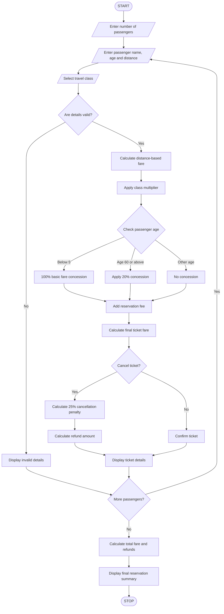

# 6. Railway Fare and Reservation Calculator

## 1. Problem Statement

The Railway Fare and Reservation Calculator is designed to calculate railway ticket fares for multiple passengers based on travel distance, travel class, passenger age, reservation fees, and cancellation penalties.

The system calculates the basic fare using distance slabs, applies age-based concessions, adds reservation charges, and calculates the final payable amount.

It also calculates the refund amount when a passenger cancels a ticket.

Example railway fare rules used in this program:

### Distance-based fare

| Distance     | Fare per km |
| ------------ | ----------- |
| First 100 km | ₹1.00       |
| 101–300 km   | ₹1.50       |
| Above 300 km | ₹2.00       |

### Travel class multiplier

| Travel class   | Multiplier |
| -------------- | ---------- |
| Sleeper        | 1.0        |
| AC 3 Tier      | 1.5        |
| AC 2 Tier      | 2.0        |
| AC First Class | 3.0        |

### Age-based concessions

- Children below 5 years: Free basic fare.
- Passengers aged 60 and above: 20% concession on basic fare.
- Other passengers: No concession.

### Additional charges

- Reservation fee: ₹50 per passenger.
- Cancellation penalty: 25% of the final ticket fare.
- Refund = Final fare − Cancellation penalty.

These are illustrative rules for an academic programming project, not official Indian Railways fares or concession policies.

## 2. Algorithm

1. Start the program.
2. Enter the number of passengers.
3. Enter the passenger's name and age.
4. Enter the journey distance in kilometres.
5. Select the travel class.
6. Calculate the basic fare using distance slabs.
7. Apply the travel class multiplier.
8. Check passenger age:
   - Below 5 years: Free basic fare.
   - 60 years or above: Apply 20% concession.
   - Otherwise: No concession.
9. Add the reservation fee.
10. Calculate the final ticket fare.
11. Ask whether the passenger wants to cancel the ticket.
12. If cancelled, calculate the 25% cancellation penalty.
13. Calculate the refund amount.
14. Display the passenger-wise fare statement.
15. Repeat the process for all passengers.
16. Calculate and display the total reservation amount.
17. Stop the program.

## 3. Flowchart


## 4. Python Source Code

```
# Railway Fare and Reservation Calculatorprint("===== RAILWAY FARE CALCULATOR =====")# Travel class multipliersclasses = {    "Sleeper": 1.0,    "AC 3 Tier": 1.5,    "AC 2 Tier": 2.0,    "AC First Class": 3.0}RESERVATION_FEE = 50CANCELLATION_RATE = 0.25# Function to calculate distance-based faredef calculate_fare(distance):    if distance <= 100:        fare = distance * 1    elif distance <= 300:        fare = (100 * 1) + (distance - 100) * 1.5    else:        fare = (100 * 1) + (200 * 1.5) + (distance - 300) * 2    return fare# Get passenger countn = int(input("Enter number of passengers: "))# Validate passenger countif n <= 0:
```

## 5. Sample Input

```
===== RAILWAY FARE CALCULATOR =====

Enter number of passengers: 2

----- Passenger 1 -----

Enter passenger name: Siva
Enter passenger age: 25
Enter journey distance (km): 250

Available Classes:
Sleeper
AC 3 Tier
AC 2 Tier
AC First Class

Enter travel class: Sleeper
Cancel ticket? (yes/no): no

----- Passenger 2 -----

Enter passenger name: Lakshmi
Enter passenger age: 65
Enter journey distance (km): 400

Enter travel class: AC 3 Tier
Cancel ticket? (yes/no): yes
```

## 6. Sample Output

```
===== TICKET DETAILS =====

Passenger Name: Siva
Age: 25
Distance: 250 km
Travel Class: Sleeper

Basic Fare: Rs. 325.0
Class Fare: Rs. 325.0
Age Concession: Rs. 0.0
Reservation Fee: Rs. 50

Final Ticket Fare: Rs. 375.0

Ticket Confirmed


===== TICKET DETAILS =====

Passenger Name: Lakshmi
Age: 65
Distance: 400 km
Travel Class: AC 3 Tier

Basic Fare: Rs. 600.0
Class Fare: Rs. 900.0
Age Concession: Rs. 180.0
Reservation Fee: Rs. 50

Final Ticket Fare: Rs. 770.0

Ticket Cancelled

Cancellation Penalty: Rs. 192.5
Refund Amount: Rs. 577.5


===== FINAL RESERVATION SUMMARY =====

Total Confirmed Ticket Fare: Rs. 375.0
Total Refund Amount: Rs. 577.5

Reservation process completed!
```

## 7. Mermaid Flowchart Code


## 8. Conclusion

The Railway Fare and Reservation Calculator calculates ticket fares for multiple passengers using distance slabs and travel class multipliers. It applies age-based concessions, adds reservation fees, calculates cancellation penalties, and displays the final refund and reservation summary.

Program completed
