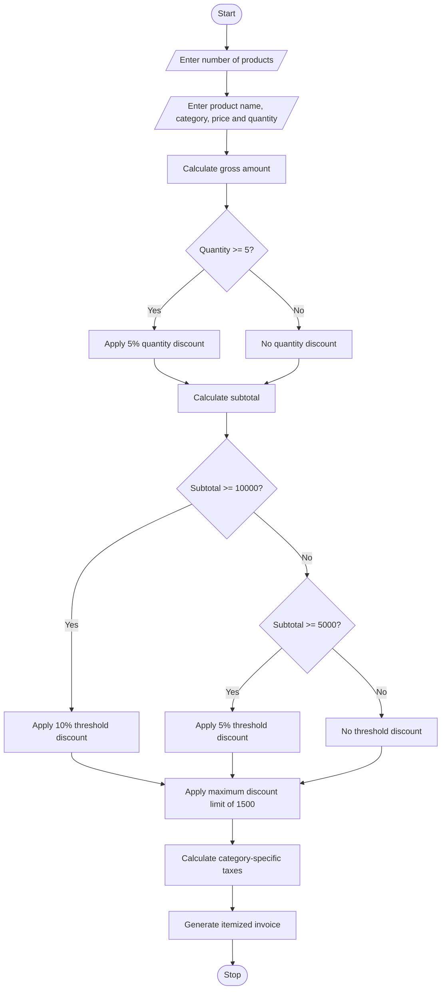

# 7. Retail Billing with Multiple Discount Rules

## 1. Problem Statement

Develop a Python program to generate an itemized retail bill for multiple products. The program should:

- Accept product names, categories, prices, and quantities.
- Calculate category-specific taxes.
- Apply a 5% quantity discount when the quantity is 5 or more.
- Apply a threshold discount:
  - 5% discount when the subtotal is ₹5,000 or more.
  - 10% discount when the subtotal is ₹10,000 or more.
- Limit the total discount to a maximum of ₹1,500.
- Display an itemized invoice with discounts, taxes, and final amount.

Tax rates used in this academic example:

| Category    | Tax rate |
| ----------- | -------- |
| Electronics | 18%      |
| Clothing    | 5%       |
| Grocery     | 0%       |

## 2. Algorithm

1. Start the program.
2. Read the number of products.
3. For each product, read its name, category, price, and quantity.
4. Calculate the gross amount for each product.
5. Apply a 5% quantity discount if quantity is 5 or more.
6. Calculate the subtotal after quantity discounts.
7. Apply the threshold discount based on the subtotal.
8. Calculate the total discount and limit it to ₹1,500.
9. Distribute the final discount proportionally among the products.
10. Calculate category-specific tax on each discounted product amount.
11. Calculate the final bill amount.
12. Display the itemized invoice.
13. Stop.

## 3. Flowchart


## 4. Python Source Code

```
# Retail Billing with Multiple Discount Rulestax_rates = {    "electronics": 18,    "clothing": 5,    "grocery": 0}products = []n = int(input("Enter number of products: "))for i in range(n):    print(f"\nEnter details for Product {i + 1}")    name = input("Product name: ")    category = input("Category (electronics/clothing/grocery): ").lower()    price = float(input("Price per unit: "))    quantity = int(input("Quantity: "))    if category not in tax_rates:        print("Invalid category!")        continue    if price <= 0 or quantity <= 0:        print("Price and quantity must be positive!")        continue    gross = price * quantity    # Quantity discount: 5% for quantity >= 5    quantity_discount = 0    if quantity >= 5:        quantity_discount = gross * 0.05
```

## 5. Sample Input

```
Enter number of products: 2

Enter details for Product 1
Product name: Laptop
Category: electronics
Price per unit: 5000
Quantity: 2

Enter details for Product 2
Product name: Shirt
Category: clothing
Price per unit: 500
Quantity: 5
```

## 6. Sample Output

```
============== RETAIL INVOICE ==============
Product       Qty   Gross   Discount   Tax   Total
Laptop         2  10000.00   1000.00 1620.00 10620.00
Shirt          5   2500.00    362.50  106.88  2244.38
--------------------------------------------
Original Subtotal       : Rs.12500.00
Quantity + Threshold Discount: Rs.1362.50
Taxable Subtotal        : Rs.11137.50
Total Tax               : Rs.1726.88
Grand Total             : Rs.12864.38
============================================
```

## 7. Mermaid Flowchart Code


🧾Prepare more billing test cases tomorrowTap to set up
