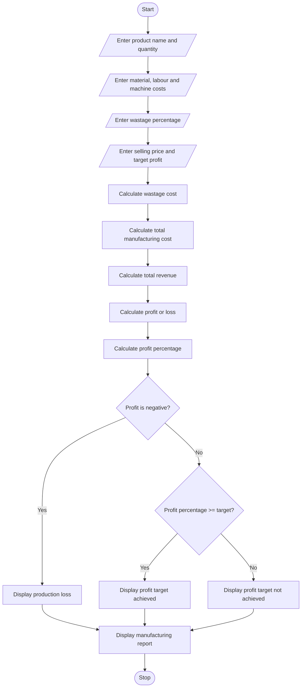

# 8. Manufacturing Cost and Profitability Analysis

## 1. Problem Statement

Develop a Python program to calculate the total manufacturing cost and profit of a product.

The program should:

1. Accept product name and production quantity.
2. Calculate material costs, labour charges and machine costs.
3. Calculate wastage cost based on the wastage percentage.
4. Calculate the total manufacturing cost.
5. Accept the selling price per unit.
6. Calculate total revenue, profit or loss, and profit percentage.
7. Compare the actual profit percentage with the specified profit target.
8. Display a complete manufacturing report.

## 2. Algorithm

1. Start.
2. Enter product name and production quantity.
3. Enter material cost, labour charges and machine cost.
4. Enter wastage percentage.
5. Enter selling price per unit and target profit percentage.
6. Calculate wastage cost.
7. Calculate total material cost.
8. Calculate total manufacturing cost.
9. Calculate total revenue.
10. Calculate profit or loss.
11. Calculate profit percentage.
12. Check whether the profit target is achieved.
13. Display the manufacturing report.
14. Stop.

## 3. Flowchart



## 4. Python Source Code

```
# Manufacturing Cost and Profitability Analysisprint("=== MANUFACTURING COST ANALYSIS ===")product_name = input("Enter product name: ")quantity = int(input("Enter production quantity: "))material_cost = float(input("Enter material cost: Rs."))labour_cost = float(input("Enter labour charges: Rs."))machine_cost = float(input("Enter machine cost: Rs."))wastage_percentage = float(input("Enter wastage percentage: "))selling_price = float(input("Enter selling price per unit: Rs."))target_profit = float(input("Enter target profit percentage: "))# Input validationif (quantity <= 0 or material_cost < 0        or labour_cost < 0 or machine_cost < 0        or selling_price < 0        or not 0 <= wastage_percentage <= 100        or target_profit < 0):    print("Invalid input! Please enter valid values.")else:    # Calculate wastage cost    wastage_cost = material_cost * wastage_percentage / 100    # Calculate total material cost    total_material_cost = material_cost + wastage_cost    # Calculate total manufacturing cost    total_cost = (        total_material_cost        + labour_cost
```

## 5. Sample Input

```
Enter product name: Chair
Enter production quantity: 100
Enter material cost: Rs.20000
Enter labour charges: Rs.10000
Enter machine cost: Rs.5000
Enter wastage percentage: 10
Enter selling price per unit: Rs.450
Enter target profit percentage: 20
```

## 6. Sample Output

```
======= MANUFACTURING REPORT =======
Product Name             : Chair
Production Quantity      : 100
Material Cost            : Rs. 20000.0
Wastage Cost             : Rs. 2000.0
Total Material Cost      : Rs. 22000.0
Labour Charges           : Rs. 10000.0
Machine Cost             : Rs. 5000.0
Total Manufacturing Cost : Rs. 37000.0
Selling Price Per Unit   : Rs. 450.0
Total Revenue            : Rs. 45000.0
Profit / Loss            : Rs. 8000.0
Profit Percentage        : 21.62 %
------------------------------------
Result: Profit target ACHIEVED.
Target Profit Percentage : 20.0 %
====================================
```

## 7. Mermaid Flowchart Code

## Important Formulas

| Calculation              | Formula                               |
| ------------------------ | ------------------------------------- |
| Wastage cost             | Material cost × Wastage % / 100       |
| Total material cost      | Material cost + Wastage cost          |
| Total manufacturing cost | Material + Wastage + Labour + Machine |
| Total revenue            | Selling price × Quantity              |
| Profit                   | Revenue − Total cost                  |
| Profit percentage        | (Profit / Total cost) × 100           |

Conclusion: This program calculates manufacturing costs and identifies whether the production meets the specified profit target.

You can view the flowchart at the [Mermaid Live Editor](https://mermaid.live/?utm_source=chatgpt.com).
