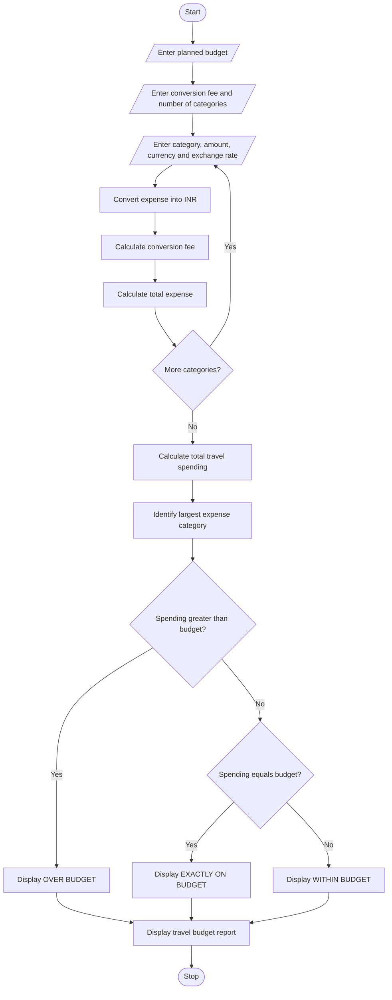

# 9. Multi-Currency Travel Budget Analysis

## 1. Problem Statement

Develop a Python program to calculate travel expenses in different currencies and compare the total spending with a planned budget.

The program should:

1. Accept the travel budget in a base currency (INR).
2. Accept multiple expense categories, such as hotel, food, transport and shopping.
3. Read the expense amount and currency for each category.
4. Convert foreign currency expenses into INR using supplied exchange rates.
5. Calculate currency conversion fees.
6. Calculate the total travel expenditure.
7. Compare actual spending with the planned budget.
8. Identify the largest expense category.
9. Display a complete travel budget report.

Assumptions for this academic example:

- All exchange rates are entered by the user.
- Conversion fee is calculated as a percentage of the converted amount.
- INR is used as the base currency.
- The exchange rates in the sample are illustrative, not live rates.

## 2. Algorithm

1. Start.
2. Enter the travel budget in INR.
3. Enter the number of expense categories.
4. For each category:
   - Enter category name.
   - Enter expense amount.
   - Enter currency code.
   - Enter exchange rate to INR.
   - Convert expense into INR.
   - Calculate conversion fee.
   - Calculate total expense including fee.
5. Calculate total travel expenditure.
6. Compare total expenditure with the planned budget.
7. Identify the largest expense category.
8. Display the travel budget report.
9. Stop.

## 3. Flowchart



## 4. Python Source Code

```
        category = input("Enter category name: ")        amount = float(input("Enter expense amount: "))        currency = input("Enter currency code (USD/EUR/INR): ").upper()        exchange_rate = float(input("Enter exchange rate to INR: "))        if amount < 0 or exchange_rate <= 0:            print("Invalid amount or exchange rate!")            continue        # Convert expense into INR        converted_amount = amount * exchange_rate        # Calculate conversion fee        conversion_fee = converted_amount * fee_percentage / 100        # Calculate total expense        total_expense = converted_amount + conversion_fee        expenses.append({            "category": category,            "currency": currency,            "amount": amount,            "converted": converted_amount,            "fee": conversion_fee,            "total": total_expense        })    if not expenses:        print("\nNo valid expenses entered.")    else:        # Calculate total expenditure        total_spending = sum(item["total"] for item in expenses)        # Identify largest expense category        largest_expense = max(expenses, key=lambda x: x["total"])        print("\n========== TRAVEL BUDGET REPORT ==========")        print("Category      Currency   Amount   INR Value   Fee    Total")        for item in expenses:            print(                f"{item['category']:<13} "                f"{item['currency']:<9} "                f"{item['amount']:>7.2f} "                f"{item['converted']:>10.2f} "                f"{item['fee']:>7.2f} "                f"{item['total']:>9.2f}"            )        print("------------------------------------------")        print(f"Planned Budget       : Rs.{budget:.2f}")        print(f"Total Travel Spending: Rs.{total_spending:.2f}")        if total_spending > budget:            print(f"Budget Exceeded      : Rs.{total_spending - budget:.2f}")            print("Status: OVER BUDGET")        elif total_spending < budget:            print(f"Remaining Budget     : Rs.{budget - total_spending:.2f}")            print("Status: WITHIN BUDGET")        else:            print("Status: EXACTLY ON BUDGET")        print("Largest Expense Category:", largest_expense["category"])        print(f"Largest Expense Amount  : Rs.{largest_expense['total']:.2f}")        print("==========================================")
```

## 5. Sample Input

```
Enter planned travel budget in INR: Rs.20000
Enter conversion fee percentage: 2
Enter number of expense categories: 3

Expense Category 1
Enter category name: Hotel
Enter expense amount: 100
Enter currency code (USD/EUR/INR): USD
Enter exchange rate to INR: 83

Expense Category 2
Enter category name: Food
Enter expense amount: 50
Enter currency code (USD/EUR/INR): EUR
Enter exchange rate to INR: 90

Expense Category 3
Enter category name: Transport
Enter expense amount: 2000
Enter currency code (USD/EUR/INR): INR
Enter exchange rate to INR: 1
```

## 6. Sample Output

```
========== TRAVEL BUDGET REPORT ==========
Category      Currency   Amount   INR Value   Fee    Total
Hotel         USD        100.00    8300.00  166.00   8466.00
Food          EUR         50.00    4500.00   90.00   4590.00
Transport     INR       2000.00    2000.00   40.00   2040.00
------------------------------------------
Planned Budget       : Rs.20000.00
Total Travel Spending: Rs.15096.00
Remaining Budget     : Rs.4904.00
Status: WITHIN BUDGET
Largest Expense Category: Hotel
Largest Expense Amount  : Rs.8466.00
==========================================
```

## 7. Mermaid Flowchart Code


## Important Formulas

| Calculation      | Formula                           |
| ---------------- | --------------------------------- |
| Converted amount | Expense × Exchange rate           |
| Conversion fee   | Converted amount × Fee % / 100    |
| Total expense    | Converted amount + Conversion fee |
| Total spending   | Sum of all total expenses         |
| Remaining budget | Budget − Total spending           |
| Budget exceeded  | Total spending − Budget           |

Conclusion: This Python program converts expenses into INR, calculates conversion fees, checks the travel budget and identifies the largest expense category.

You can view the flowchart using the [Mermaid Live Editor](https://mermaid.live/?utm_source=chatgpt.com).
